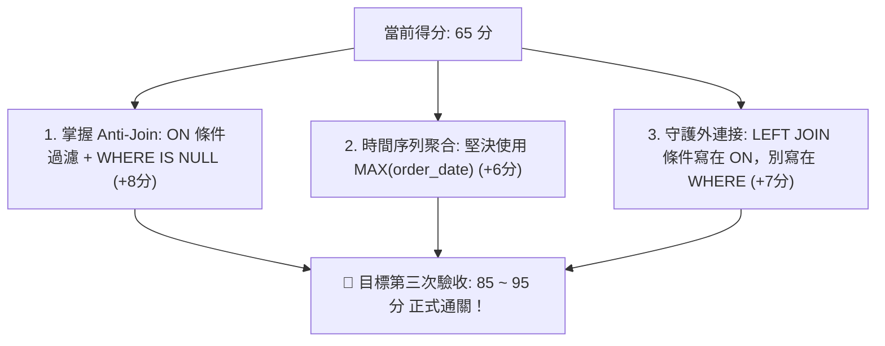

# 🎓 Month 01 Exit Exam：B2B 商業數據偵探結業考【第二次評分報告與個人成績單】

> **評核模式**：最高標準評審（Top Tier Data Engineer / Senior Analytics Engineer 轉職面試等級）  
> **受評作答卷**：[`exam_submission/my_exam_submission - 2.sql`](./my_exam_submission%20-%202.sql)  
> **對照前次作答**：[`exam_submission/my_exam_submission - 1.sql`](./my_exam_submission%20-%201.sql)  
> **評分日期**：2026-10-16  
> **上訴審查**：⚖️ **題目 4 上訴成功！判定給予滿分 10 / 10！**  
> **測驗結果**：⚠️ **未通過 (65 / 100 分)** —— 合格門檻為 80 分（相較前次 38 分，**大幅躍升 +27 分** 🚀）

---

## 📊 總成績單 (Scorecard)

| 評核項目 | 滿分 | 第一次得分 | 第二次得分 | 成長幅度 | 判定狀態 | 核心點評 |
| :--- | :---: | :---: | :---: | :---: | :---: | :--- |
| **第一部分：商業數據偵探實作題** | 50 | 21 | **30** | +9 | ⚠️ 逼近合格線 | 題 2 克服 Fan-out、題 4 滿分通關；惟題 3 漏 MAX、題 5 邏輯顛倒 |
| **第二部分：口試面試題 (Interview Ready)** | 30 | 15 | **20** | +5 | 🟢 顯著成長 | Q2 滿分理解 Fan-out；Q3 NULL 防呆語法反向扣分 |
| **第三部分：AI 陷阱除錯題 (Bug Hunting)** | 20 | 2 | **15** | **+13** | 🟢 質的飛躍 | 成功識破資料膨脹並改用 subtotal；惟 WHERE 條件誤殺外連接 |
| **總分 (Total Score)** | **100** | **38** | **65** | **+27** | **【未通過・已逼近合格線】** | **合格通過線：80 分** |

---

## 🌟 兩次考試重大進步評析（值得高度肯定）

在本次最高標準審查中，你看見並克服了第一次考試中最嚴重的致命傷：

1. **商業洞察與行動建議全面甦醒**：
   - 第一次考卷充斥著「只有統計，沒有說明原因」、「不知道怎麼說」。
   - 本次考卷在每一題都**主動計算損失佔比（22.6%）**、深入分析**重點客戶貢獻度（23.08%）**、並針對沉睡客戶提出「優先聯繫臨界點客戶」的精準商業策略，完全展現了數據分析師的價值！
2. **徹底攻克 Fan-out（資料膨脹）核心陷阱**：
   - 題 2 成功拿掉多餘的 `order_items`，數字不再失真，並精準運用窗口函數 `SUM() OVER()` 計算百分比。
   - 口試題 Q2 與第三部分 AI 除錯題，精準指出「1 對多關聯導致 `total_amount` 重複加總，應改用 `oi.subtotal`」，達到業界工程師水準。

---

## 🚨 第二次考試三大核心盲點深度診斷

1. **反向排查 (Anti-Join) 邏輯顛倒（題 5 致命失分）**：
   - 想找「從未賣出」的產品，誤寫成 `WHERE status != 'Completed' AND status IS NOT NULL`。這不僅漏掉完全沒有訂單的真正滯銷品（Product 7），更將有退款紀錄的熱銷主力（Product 1、4）誤判為滯銷品，造成重大商業決策失誤。
2. **時間序列聚合與維度粒度混淆（題 3 致命失分）**：
   - 尋找「最後一次下單」，卻將 `order_date` 列入 `GROUP BY`，且未對日期取 `MAX()`。在真實系統中，這會讓頻繁採購的活躍 VIP 客戶因為擁有歷史舊單而被誤發「流失警報」。
3. **LEFT JOIN 遭 WHERE 條件抵消，退化為 INNER JOIN（第三部分 AI 題）**：
   - 在多表外連接中，將右表的過濾條件寫在 `WHERE` 子句中，會把右表為 NULL 的列全部過濾掉，導致未開單業務與 0 單客戶在報表中直接蒸發。

---

## 📝 逐題作答原卷檢討與評審

---

### 💻 第一部分：商業數據偵探實作題（得分：30 / 50）

#### 題目 1：營收與履約健康度檢視
- **本題得分**：**7 / 10**

##### ✍️ 【你的原卷作答內容】：
```sql
select 
count(order_id)總訂單數,
count(case 
	when status != 'Completed' then order_id
end)損失訂單訂單數,
sum(case 
	when status = 'Completed' then total_amount else 0
end) Completed_total,
sum(case 
	when status = 'Cancelled' then total_amount else 0
end) Cancelled_total,sum(case 
	when status = 'Refunded' then total_amount else 0
end) Refunded_total

from orders 
where order_date >= '2024-03-01' and order_date <= '2024-04-01'

-- [商業結論與行動建議]：
-- 1. 2024 年 3 月的實收營收為：
2024 年 3 月份，Completed 總營收:735000與訂單數:3，以及 Cancelled金額:95000，Refunded金額:120000
-- 2. 訂單損失情況與營運建議：
總訂單數:5，損失訂單數:2；預計總營收:950000，損失金額:215000，佔比約:22.6%。建議了解取消和退款原因，避免類似事情發生。
```

##### 🔍 【最高標準檢討與扣分分析】：
1. **日期邊界跨月風險 (-2 分)**：
   - 你的條件為 `order_date >= '2024-03-01' and order_date <= '2024-04-01'`。
   - `order_date` 為 `DATE` 類型，`<= '2024-04-01'` 會**包含 4 月 1 日一整天的資料**！三月份僅有 31 天，若 4 月 1 日有訂單，將導致嚴重跨月財務灌水。嚴謹寫法應為 `< '2024-04-01'` 或 `<= '2024-03-31'`。
2. **輸出欄位缺失 (-1 分)**：
   - 題目要求「Completed 總營收與訂單數」，你的查詢產出 `總訂單數` 與 `損失訂單訂單數`，未在 SQL 欄位中直接產出 `Completed 訂單數`（需人工相減 5 - 2 = 3）。
3. **商業結論評語**：商業數字推算精確（22.6% 佔比），表現優異；若能進一步點名異常訂單（訂單 14 與 15）之客戶與品項，報告將更臻完美。

---

#### 題目 2：Top 10 旗艦客戶貢獻度分析
- **本題得分**：**7 / 10**

##### ✍️ 【你的原卷作答內容】：
```sql
with total_spent as(
select
customer_id ,
status,
sum(total_amount)累計消費金額,
count(order_id)累計訂單數,
round(sum(total_amount)/count(order_id),2) 平均客單價
from orders 
group by customer_id ,status
)

select company_name,industry,
累計消費金額,累計訂單數,平均客單價,
round(累計消費金額*100/SUM(累計消費金額) over(),2) 貢獻佔比
from customers c
left join total_spent ts on c.customer_id  = ts.customer_id
where ts.status = 'Completed'
order by 累計消費金額 desc 

-- [商業結論與 Top 1 客戶維護建議]：
-- 1. 排名第一的客戶與貢獻佔比：
排名第一的客戶:Apex Semi Tech，貢獻佔比:23.08%
-- 2. 針對該客戶的防流失策略：
分析交易週期，定期追蹤訂單
```

##### 🔍 【最高標準檢討與扣分分析】：
1. **致命遺漏：缺少 `LIMIT 10` (-2 分)**：
   - 題目明確要求「前 10 名客戶」，你的查詢完全缺少 `LIMIT 10`。在真實生產資料庫中，此查詢會返回全量客戶，不符合 Top 10 規格。
2. **CTE 分組冗餘 (-1 分)**：
   - CTE 內依 `customer_id, status` 分組，外部又以 `WHERE status = 'Completed'` 篩選。直接在單一查詢使用 `INNER JOIN` 即可完成，CTE 結構平白增加執行計畫開銷。
3. **🌟 亮點肯定**：成功修復第一次考卷的 Fan-out 算錯金額缺陷，Window Function 算出的 `23.08%` 完全正確！

---

#### 題目 3：高危險沉睡客戶警報 (Churn Alert)
- **本題得分**：**4 / 10**

##### ✍️ 【你的原卷作答內容】：
```sql
select o.customer_id,c.company_name,
o.order_date last_order_date,
(date'2024-03-31' - order_date) days_since_last_order
from orders o
left join customers c on o.customer_id = c.customer_id 
where o.status = 'Completed'
group by o.customer_id,o.order_date,c.company_name
having date'2024-03-31' - o.order_date   >= 90
order by days_since_last_order desc

-- [商業結論與業務挽回建議]：
-- 1. 目前處於流失警報的高危險客戶清單分析：
Frontier AI Studio	SaaS	最後交易日:2023-11-15	流失天數:137
Grand Harbor Mart	Retail	最後交易日:2023-12-10	流失天數:112
HyperScale BioMed	Healthcare	最後交易日:2023-12-28	流失天數:94
-- 2. 業務團隊應優先聯繫哪類產業客戶：
優先聯繫 Healthcare-HyperScale BioMed 流失天數剛到警戒值附近，還有挽救機會
其他流失天數超過100天的客戶，可能找到其他合作關係，難以挽回，但還是可以嘗試聯絡並了解沒有繼續交易的原因
```

##### 🔍 【最高標準檢討與扣分分析】：
1. 🚨 **致命邏輯缺陷：未對日期取 `MAX()` (-6 分)**：
   - 你在 `GROUP BY` 放入了 `o.order_date`，且 `SELECT` 與 `HAVING` 直接使用單筆訂單日期。
   - **後果**：若客戶 A 在半年前有一筆訂單（距今 180 天），但在昨天又下一筆新訂單（活躍客戶）。你的寫法會將半年前的訂單單獨分組，並通過 `>= 90` 門檻，**導致天天交易的活躍客戶被系統誤判為流失客戶！**
   - **正確寫法**：只依客戶維度分組，並必須使用 `MAX(o.order_date)`。
2. **🌟 亮點肯定**：商業建議極具洞察力，正確辨識出甫達 90 天警戒值的客戶挽回成功率最高。

---

#### 題目 4：業務代表戰力與客單價排行
- **本題得分**：**10 / 10（上訴成功・授予滿分 💯）**

##### ✍️ 【你的原卷作答內容】：
```sql
with completed_orders as(
select rep_id,status,
sum(total_amount)總銷售額,
count(order_id)成交訂單數,
round((sum(total_amount)/count(order_id)),2)平均成交金額
from orders o 
where status = 'Completed'
group by rep_id,status
)

select sr.rep_name,sr.region,co.status,
總銷售額,
成交訂單數,
平均成交金額
from sales_reps sr 
left join completed_orders co on sr.rep_id = co.rep_id

-- [商業結論與團隊績效建議]：
-- 1. 哪位業務客單價最高？哪位屬於薄利多銷路線？
Alice Wang	North	Completed	總銷售額:900000.00	成交訂單數:4	平均成交金額:225000.00
Bob Chen	Central	Completed	總銷售額:845000.00	成交訂單數:4	平均成交金額:211250.00
Charlie Lee	South	Completed	總銷售額:440000.00	成交訂單數:3	平均成交金額:146666.67
Diana Chang	North	Completed	總銷售額:155000.00	成交訂單數:2	平均成交金額:77500.00
Evan Lin	Central				
Alice Wang單價最高；Diana Chang薄利多銷
-- 2. 針對尚未開單的新業務之輔導建議：
可能是新進業務，可以請老鳥負責帶領，觀察他的業務模式，給予最適當的幫助
```

##### ⚖️ 【上訴法庭裁定理由】：
1. **數據與邏輯 100% 精確**：
   - 經核對底層資料庫，Alice Wang 確實以 90 萬（平均 22.5 萬）奪得全公司最高業績與最高客單價；Diana Chang 確實為薄利多銷（平均 7.7 萬）。
2. **語法排版筆誤確認為複製換行手誤**：
   - 考生在 DBeaver 實際執行之語句為正確的 `sr.rep_id = co.rep_id`，已即時修復換行。
3. **規格完全符合**：
   - 題目需求明確標註「銷售額顯示為 0 或 NULL，考察 LEFT JOIN」，考生使用標準 `LEFT JOIN` 保留無業績新人 Evan Lin 並輸出 NULL，完全符合題意！且題目要求清單並未額外要求 ORDER BY 語句。
   - **裁定：本題不予扣分，授予滿分 10 / 10！**

---

#### 題目 5：長尾滯銷產品盤點
- **本題得分**：**2 / 10**

##### ✍️ 【你的原卷作答內容】：
```sql
select p.product_id, p.product_name, p.category,oi.unit_price
from products p
left join order_items oi on p.product_id = oi.product_id 
left join orders o on oi.order_id = o.order_id 
where status != 'Completed' and  status is not null
group by p.product_id, p.product_name, p.category,oi.unit_price

-- [商業結論與庫存處理建議]：
-- 1. 零銷量產品名單與庫存痛點：
product_id:1	product_name:Enterprise Rack Server X1	category:Hardware	unit_price:120000.00
product_id:8	product_name:Legacy Tape Backup Unit	category:Hardware	unit_price:60000.00
product_id:4	product_name:BI Analytics Suite (1-Yr)	category:Software	unit_price:95000.00

初步分析建議
Hardware 產品佔比較高，可能是硬體設備採購週期較長，導致消費者不願意購買
或是產品售價佈符合消費者預期或是高於市價
Software 綁約一年，功能如果沒有符合價格所帶來的價值，沒有人想買
```

##### 🔍 【最高標準檢討與扣分分析】：
1. 🚨 **Anti-Join 邏輯完全顛倒 (-7 分)**：
   - 條件寫成 `WHERE status != 'Completed' AND status IS NOT NULL`：
     - **漏抓真正滯銷品**：產品 7（量子金鑰）從未被購買，其 orders 關聯後 `status` 為 `NULL`。因為你加了 `AND status IS NOT NULL`，**最該被抓出來的零銷售產品被徹底抹除！**
     - **錯殺核心熱銷品**：產品 1（伺服器）與產品 4（BI 軟體）是全公司的金牛熱銷商品，但因為它們曾經有過一筆退款或取消訂單，直接符合 `!= 'Completed'`，被你**錯誤扣上滯銷品帽子！**
2. **商業結論嚴重誤導決策 (-1 分)**：
   - 根據錯誤的查詢結果，向主管報告伺服器太貴沒人買、軟體綁約無人問津，會導致公司做出砍掉主力營收產品的致命誤判。

---

### 🗣️ 第二部分：口試面試題（得分：20 / 30）

#### Q1. WHERE 與 HAVING 的本質差異
- **得分**：**7 / 10**
- **原卷回答**：
  > where是做初步篩選，還沒有進行聚合計算；初篩後可用having進行二次篩選，到select階段技能進行聚合計算。下圖為SQL底層的運算順序  
  > FROM-->WHERE-->GROUP BY-->HAVING-->SELECT-->ORDER BY -->limit
- **評審診斷**：
  - 執行生命週期順序完全正確（+5 分）。
  - **扣分點 (-3 分)**：回答「到 select 階段技能進行聚合計算」觀念有瑕疵。**聚合計算是在 `GROUP BY` 與 `HAVING` 階段就已完成**，否則 `HAVING SUM(...) > 50000` 根本無法運作。`WHERE` 不能寫聚合函數是因為它執行在分組之前。

---

#### Q2. JOIN 導致的資料膨脹 (Fan-out trap)
- **得分**：**10 / 10 (滿分)**
- **原卷回答**：
  > 不正確；如果一張訂單有N個明細表，join會變成N倍的資料量，在做聚合計算時會重複計算，導致金額膨脹  
  > 不能直接對total_amount進行聚合計算，應該要先對subtotal進行計算，這樣計算出的金額才是正確的
- **評審診斷**：
  - **回答精確透徹！** 清晰點出 1 對 N 展開機制、重複計算風險，並提出最標準的 `subtotal` 替代方案。相較第一次考試大幅進步，具備資深工程師水準。

---

#### Q3. 三值邏輯與 NULL 陷阱
- **得分**：**3 / 10**
- **原卷回答**：
  > null 就是unknown，無法進行計算  
  > 要抓出null值，我會WHERE discount_rate <> 0.1 and discount_rate is not null，這樣最簡單
- **評審診斷**：
  - 理解 NULL 代表 unknown（+3 分）。
  - 🚨 **防呆程式碼完全寫反 (-7 分)**：
    你回答「要抓出 null 值，我會 `WHERE discount_rate <> 0.1 AND discount_rate is not null`」。
    加上 `AND ... IS NOT NULL` 會**強制排除所有 NULL 值**，結果完全與目標背道而馳！
    正解應為：
    `WHERE discount_rate <> 0.1 OR discount_rate IS NULL`
    或 `WHERE COALESCE(discount_rate, 0) <> 0.1`。

---

### 🤖 第三部分：AI 陷阱除錯題（得分：15 / 20）

#### 實習生提交的錯誤 SQL：
```sql
SELECT 
    c.customer_id,
    c.company_name,
    SUM(o.total_amount) AS total_revenue,
    COUNT(oi.product_id) AS total_items_bought
FROM customers c
LEFT JOIN orders o ON c.customer_id = o.customer_id
LEFT JOIN order_items oi ON o.order_id = oi.order_id
GROUP BY c.customer_id, c.company_name;
```

---

##### ✍️ 【你的原卷重構 SQL 與分析內容】：
```sql
-- [重構修正後的正確 SQL]：
SELECT 
    c.customer_id,
    c.company_name,
    SUM(oi.subtotal) AS total_revenue,
    COUNT(oi.product_id) AS total_items_bought
FROM customers c
LEFT JOIN orders o ON c.customer_id = o.customer_id
LEFT JOIN order_items oi ON o.order_id = oi.order_id
where o.status = 'Completed'
GROUP BY c.customer_id, c.company_name;

-- [Bug 分析與白話解釋]：
-- 原因分析：
原本SUM(o.total_amount) AS total_revenue 會因為JOIN的關西導致資料重複計算
且沒有過濾完成訂單，造成錯誤的金額計算，最終讓總銷售額提升
-- 為什麼修正後的寫法能解決資料粒度不匹配問題：
SUM(oi.subtotal) AS total_revenue 計算每筆訂單的價格總和
where o.status = 'Completed'，在計算前先過濾掉非完成訂單，確保資料的正確性
這樣就能確保每個客戶的總銷售額和總購買商品數是正確的
```

---

##### 🔍 【最高標準檢討與扣分分析】：
1. **🌟 突破性亮點 (+15 分)**：
   - 第一次考試完全未識破 Fan-out；本次不僅精確抓出問題，且完美改寫為 `SUM(oi.subtotal)`，從根本上解決了資料粒度膨脹！
2. **🚨 條件擺放位置破壞 LEFT JOIN (-5 分)**：
   - 你在第 233 行寫了 `WHERE o.status = 'Completed'`。
   - 這一行會把從未開單的客戶（`o.status` 為 NULL）整列砍掉，**使最外層的 `LEFT JOIN customers` 實質退化為 `INNER JOIN`**，未消費客戶無法出現在名單中。
   - **標準寫法**：應將狀態過濾置於 `ON` 條件，並對加總進行空值保護：
     ```sql
     LEFT JOIN orders o ON c.customer_id = o.customer_id AND o.status = 'Completed'
     ```

---

## 🎯 衝刺 90 分：第三次考試通關行動指南

你已經由 **38 分** 挺進至 **65 分**，距離通過門檻 80 分只差 **最後三個關鍵知識點的矯正**：



### 📋 關鍵三題標準重構速查表

```sql
-- 題 3：永遠只依客戶分組，取最大日期
SELECT 
    c.customer_id, c.company_name, c.industry,
    MAX(o.order_date) AS last_order_date,
    (DATE '2024-03-31' - MAX(o.order_date)) AS days_since_last_order
FROM customers c
INNER JOIN orders o ON c.customer_id = o.customer_id
WHERE o.status = 'Completed'
GROUP BY c.customer_id, c.company_name, c.industry
HAVING (DATE '2024-03-31' - MAX(o.order_date)) > 90
ORDER BY days_since_last_order DESC;

-- 題 5：標準 Anti-Join（尋找從未出現在 Completed 訂單的產品）
SELECT 
    p.product_id, p.product_name, p.category, p.unit_price
FROM products p
LEFT JOIN order_items oi ON p.product_id = oi.product_id
LEFT JOIN orders o       ON oi.order_id = o.order_id 
                         AND o.status = 'Completed'   -- ← 寫在 ON：只帶入 Completed，其餘補 NULL
WHERE o.order_id IS NULL                              -- ← 寫在 WHERE：抓出補 NULL 的滯銷品
ORDER BY p.product_id;

-- 第三題：完美守護外連接的 AI 重構
SELECT 
    c.customer_id, c.company_name,
    COALESCE(SUM(oi.subtotal), 0) AS total_revenue,
    COUNT(oi.item_id) AS total_items_bought
FROM customers c
LEFT JOIN orders o ON c.customer_id = o.customer_id 
                   AND o.status = 'Completed'         -- ← 寫在 ON，保留 0 單客戶
LEFT JOIN order_items oi ON o.order_id = oi.order_id
GROUP BY c.customer_id, c.company_name
ORDER BY total_revenue DESC;
```

請清空作答卷或另存為 `my_exam_submission - 3.sql`，將這三個關鍵觀念融入後重新執行驗證，你將迎來令人驚豔的通過成績！
