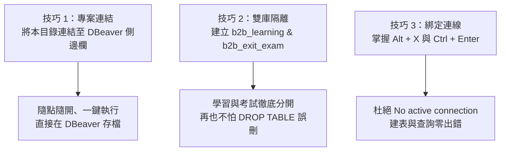

# 🐬 DBeaver 最佳實踐：專案連結與雙資料庫設定指南

> **「學會這招，再也不用在 VS Code 與 DBeaver 之間反覆複製貼上程式碼！」**  
> 本指南將手把手教你如何將本學習專案「連結」進 DBeaver 側邊欄，以及如何設定「學習庫」與「考試庫」雙庫隔離，讓你的資料永遠不被覆蓋！

---

## 🗺️ 核心目標一覽



---

## 一、🌟 技巧 1：將本專案「連結」到 DBeaver 側邊欄（隨點隨開）

許多初學者不知道 DBeaver 具備「專案管理」功能，每次都要在 VS Code 複製程式碼再切回 DBeaver 貼上。只要設定一次「連結資料夾」，你就能在 DBeaver 左側直接看到所有 `.sql` 檔！

### 步驟圖解：

1. 開啟 **DBeaver**。
2. 查看 DBeaver 介面左側面板，點擊 **「專案 (Projects)」** 分頁標籤（通常在「資料庫導覽」旁邊；若沒看到，可由頂部選單 `視窗 (Window) ➜ 顯示視圖 (Show View) ➜ 專案 (Projects)` 開啟）。
3. 展開專案樹狀圖：`General` ➜ 找到 **`腳本 (Scripts)`** 資料夾。
4. 在 **`腳本 (Scripts)`** 上按 **滑鼠右鍵** ➜ 點選 **「連結資料夾 (Link Folder...)」**。
5. 在彈出的視窗中：
   - 點擊「瀏覽 (Browse...)」。
   - 選取本機資料夾：`d:\Jay\vscode\轉職計畫\轉職計畫\01_Month01_SQL基礎`。
   - 點擊「確定」。
6. 🎉 **完成！** 此時你在 DBeaver 左側的 Scripts 底下就會直接看見：
   - 📂 `01_學習篇` ➜ 裡面有 `01_b2b_learning_init.sql`、`my_learning_practice.sql`
   - 📂 `02_考試篇` ➜ 裡面有 `01_b2b_exam_init.sql`、`my_exam_submission.sql`
   > **以後只要對著檔案連點兩下，就會直接在 DBeaver 內開啟編輯並即時存檔！**

---

## 二、🛡️ 技巧 2：建立雙獨立資料庫（學習 vs 考試 零衝突）

學習篇（01~09）使用的是 `salespeople`, `customers`, `products`, `orders`, `order_items`；  
結業考（10）使用的是 `sales_reps`, `customers`, `products`, `orders`, `order_items`。  
兩份初始化腳本開頭都有 `DROP TABLE IF EXISTS ... CASCADE`。  
為了避免考試時把平時練習的資料庫沖掉，**請在 PostgreSQL 內建立 2 個獨立資料庫**：

```
PostgreSQL Server (本機)
  ├── 📘 b2b_learning    (專門用於平時 01~09 關卡學習與 30 道練習題)
  └── 🎓 b2b_exit_exam   (專門用於 Month 01 結業考專屬考場)
```

### 操作步驟（只需 30 秒）：

1. 在 DBeaver 左側切換到 **「資料庫導覽 (Database Navigator)」**。
2. 展開你的 PostgreSQL 連線 ➜ 找到 **「資料庫 (Databases)」**。
3. 對著「資料庫 (Databases)」按 **滑鼠右鍵** ➜ 點選 **「建立新資料庫 (Create New Database)」**：
   - 第 1 個填入：**`b2b_learning`** ➜ 點擊確定。
4. 再次對著「資料庫 (Databases)」按 **滑鼠右鍵** ➜ 點選 **「建立新資料庫 (Create New Database)」**：
   - 第 2 個填入：**`b2b_exit_exam`** ➜ 點擊確定。
5. 在「資料庫」目錄按鍵盤 **`F5`** 重新整理，你會看到這兩個庫已經整齊出現！

---

## 三、🚀 技巧 3：初始化匯入與切換連線

### 1. 初始化學習資料庫 (`b2b_learning`)
1. 在 DBeaver 展開 `b2b_learning` ➜ 按 **滑鼠右鍵** ➜ 點選 **「SQL 編輯器」➜「新增 SQL 腳本」**（或從左側專案直接雙擊開啟 `01_學習篇/database/01_b2b_learning_init.sql`）。
2. **重要！檢查右上角連線狀態**：
   - 確認編輯器工具列右上角顯示為：`<連線名稱> - b2b_learning`。
3. 按下鍵盤 **`Alt + X`**（執行整份腳本）：
   - 執行完畢後下方會跳出通知：`🎉 b2b_learning 學習資料庫初始化成功！`
4. 展開 `b2b_learning ➜ Schemas ➜ public ➜ Tables` 並按 `F5`，確認 5 張表已就緒。

---

### 2. 初始化結業考資料庫 (`b2b_exit_exam`)
1. 在 DBeaver 展開 `b2b_exit_exam` ➜ 按 **滑鼠右鍵** ➜ 點選 **「SQL 編輯器」➜「新增 SQL 腳本」**（或從左側專案直接雙擊開啟 `02_考試篇/database/01_b2b_exam_init.sql`）。
2. **重要！檢查右上角連線狀態**：
   - 確認編輯器工具列右上角顯示為：`<連線名稱> - b2b_exit_exam`。
3. 按下鍵盤 **`Alt + X`**（執行整份腳本）：
   - 執行完畢後下方會跳出通知：`🎓 b2b_exit_exam 結業考專屬資料庫初始化成功！`
4. 展開 `b2b_exit_exam ➜ Schemas ➜ public ➜ Tables` 並按 `F5`，考題環境建置完成。

---

## 四、⚡ DBeaver 高效快捷鍵速查表

| 功能操作 | 快捷鍵 | 適用時機與情境 |
| :--- | :---: | :--- |
| **執行單一行 / 當前語句** | **`Ctrl + Enter`** | 平時練習寫 `SELECT` 查詢時，游標停在該行即可快速看結果 |
| **執行整份腳本 (Execute Script)** | **`Alt + X`** | 初始化資料庫（`init.sql`）或批次建表時使用（圖示為雙箭頭 ▶▶） |
| **新增 SQL 腳本分頁** | **`Ctrl + ]`** | 想快速開新分頁測試小語法時 |
| **重新整理目錄視圖** | **`F5`** | 執行建表後，在左側「表 (Tables)」上按 F5 才會看到新資料表 |
| **格式化 SQL 程式碼** | **`Ctrl + Shift + F`** | 自動排版縮排、對齊關鍵字，保持程式碼整潔 |
| **切換註解** | **`Ctrl + /`** | 快速將選取的 SQL 程式碼加上或取消 `--` 註解 |

---

## 五、❓ 常見疑難排解 (FAQ)

### Q1：點執行跳出「No active connection」錯誤？
- **原因**：打開了檔案，但該分頁沒有被指定連線到哪一個資料庫。
- **解法**：在編輯器視窗右上角，有兩個下拉選單：
  1. 第一個選單選取你的 PostgreSQL 連線（例如 `localhost:5432`）。
  2. 第二個選單選取具體目標資料庫（例如 `b2b_learning` 或 `b2b_exit_exam`）。

### Q2：執行腳本時跳出「relation already exists」或「foreign key constraint fail」？
- **原因**：因為先前建表未完全或表格相依性問題。
- **解法**：我們的初始化腳本開頭均已設定 `DROP TABLE IF EXISTS ... CASCADE`，只要直接按下 **`Alt + X`**（整份腳本重新執行），就會全自動乾淨推倒重建！
